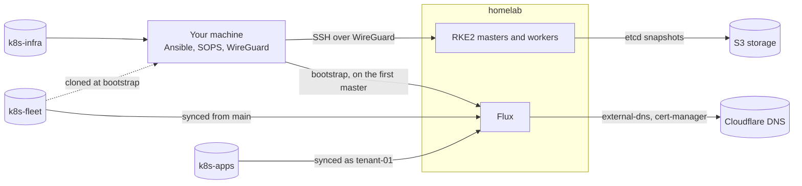

# Onboarding

What to know before working on the `homelab` cluster: how the repositories fit together, and the one-time setup before the first build. The details are in the READMEs of [k8s-infra](README.md) and [k8s-fleet](https://github.com/nathansiegfrid/k8s-fleet#readme).

## The big picture

Three repositories make up the cluster:

| Repository | Holds | Applied by |
| --- | --- | --- |
| k8s-infra (this one) | Ansible for the hosts, the WireGuard mesh, RKE2 and the Flux bootstrap | You, from your machine, with `ansible-playbook` |
| [k8s-fleet](https://github.com/nathansiegfrid/k8s-fleet) | Everything that runs on the cluster: platform, policies, tenants | Flux, continuously, from `main` |
| [k8s-apps](https://github.com/nathansiegfrid/k8s-apps) | tenant-01's workloads | Flux, as tenant-01, inside tenant-01's namespace |



### How a cluster comes up

1. `01-mesh.yaml` prepares every host: the admin user and SSH hardening, then the WireGuard mesh. It ends by listing the nodes your machine can't reach over WireGuard yet.
2. You import your machine's client config from `generated/` and check that it reaches every node. Everything after this connects over WireGuard.
3. `02-cluster.yaml` sets up the OS and RKE2 on the nodes. The nodes stay `NotReady` until Cilium runs.
4. `03-flux.yaml` bootstraps Flux. It makes a fresh clone of k8s-fleet's `main` on your machine, so a local edit can't reach the cluster, then, on the first master, installs Cilium and Flux Operator with Helm from that clone's files, creates two Secrets, and applies the FluxInstance. Cilium goes first because nothing schedules without a CNI, Flux included.
5. Flux syncs `clusters/homelab` from GitHub and adopts the Cilium and Flux Operator releases. From then on k8s-fleet owns them: don't change them with Ansible or Helm again.
6. Flux applies the rest in dependency order: the Gateway API CRDs, the host firewall, cert-manager, external-dns and Istio, then the Gateway, then the tenants, after the admission policies for their namespaces.
7. Each tenant's repository syncs into its own namespace, with `admin` rights there and nowhere else.

### Where a change goes

| To change | Edit | Then |
| --- | --- | --- |
| Hosts, SSH access, WireGuard peers | k8s-infra | `ansible-playbook 01-mesh.yaml` |
| A new node | k8s-infra | `ansible-playbook 01-mesh.yaml`, import the new client config, then `ansible-playbook 02-cluster.yaml` |
| RKE2's version or config, OS packages | k8s-infra | `ansible-playbook upgrade.yaml`, which drains and reboots one node at a time |
| The deploy key or the cluster's age key | k8s-infra's `secrets.sops.yaml` | `ansible-playbook 03-flux.yaml`, which updates the two Secrets |
| Anything running on the cluster | k8s-fleet | Push to `main`; Flux applies it |
| A tenant's workloads | The tenant's repository | Push; Flux applies it as that tenant |
| A version | Nothing | Merge Renovate's pull request. For RKE2, then run `upgrade.yaml` |

### Keys and secrets

Secrets in both repositories are encrypted with SOPS and age.

| Secret | Private part kept in | Used by |
| --- | --- | --- |
| Your age key | Your machine only | You, to edit secrets in both repositories |
| The cluster's age key | k8s-infra's `secrets.sops.yaml`, then the `flux-system/sops-age` Secret | Flux, to decrypt k8s-fleet's secrets |
| The deploy key | k8s-infra's `secrets.sops.yaml`, then the `flux-system/flux-system` Secret | Flux, to read k8s-fleet |
| RKE2 join tokens, etcd S3 credentials | k8s-infra's `secrets.sops.yaml` | The nodes |
| Cloudflare API tokens, one each | k8s-fleet's `platform/external-dns/` and `platform/cert-manager/` `cloudflare-api-token.sops.yaml` | external-dns, for DNS records, and cert-manager, for Let's Encrypt's DNS-01 challenge |

The public parts: your age key goes in both `.sops.yaml` files, the cluster's age key in k8s-fleet's `.sops.yaml`, and the deploy key on GitHub, as a read-only deploy key on k8s-fleet.

## Setup checklist

### Tools

- [ ] Ansible, and the collections: `ansible-galaxy collection install -r requirements.yaml`
- [ ] SOPS and age: `brew install sops age`
- [ ] WireGuard, to join the mesh
- [ ] SSH access to k8s-fleet on GitHub: `03-flux.yaml` clones it
- [ ] Optional, kubectl on your machine: copy `~/.kube/config` from a master. The masters already have kubectl and the admin user's kubeconfig.
- [ ] Optional, to run k8s-fleet's `scripts/validate.sh`: [kubeconform](https://github.com/yannh/kubeconform) and the [flux-operator CLI](https://github.com/controlplaneio-fluxcd/flux-operator/releases)

### Keys

- [ ] **Your age key.** SOPS looks for it in `~/Library/Application Support/sops/age/keys.txt` on macOS and `~/.config/sops/age/keys.txt` on Linux, or wherever `SOPS_AGE_KEY_FILE` points.

	```sh
	mkdir -p ~/Library/Application\ Support/sops/age
	age-keygen -o ~/Library/Application\ Support/sops/age/keys.txt
	```

	Back it up somewhere safe: without it, no secret in either repository can be decrypted. Put its public key (`age-keygen -y <file>`) in both `.sops.yaml` files, then run `sops updatekeys` on every existing `*.sops.yaml`.
- [ ] **The cluster's age key.** Run `age-keygen -o cluster.agekey`. Put its public key in k8s-fleet's `.sops.yaml`. The private key goes into k8s-infra's `secrets.sops.yaml` below; delete the file after that.
- [ ] **The deploy key.** Run `ssh-keygen -t ed25519 -N '' -f k8s-fleet-deploy` and add the `.pub` to k8s-fleet as a read-only deploy key. The private key goes into k8s-infra's `secrets.sops.yaml`.

### k8s-fleet

- [ ] **The Cloudflare tokens.** Create two API tokens, one for external-dns and one for cert-manager, each with Zone Read and DNS Edit on the cluster's zone only. Put each in its file with `sops`, which encrypts on save:

	```sh
	sops platform/external-dns/cloudflare-api-token.sops.yaml
	sops platform/cert-manager/cloudflare-api-token.sops.yaml
	```

	```yaml
	apiVersion: v1
	kind: Secret
	metadata:
	  name: cloudflare-api-token
	  namespace: external-dns # or cert-manager
	stringData:
	  token: <the token>
	```

### k8s-infra

- [ ] **The secrets.** Run `sops inventory/group_vars/k8s_nodes/secrets.sops.yaml` and fill in the template from the [README](README.md#setup).
- [ ] **The inventory.** Create `inventory/hosts.yaml` from `inventory/hosts.yaml.example`. It's git-ignored because it holds the real IPs.

### First build

- [ ] Run `ansible-playbook 01-mesh.yaml`. It ends by listing the nodes your machine can't reach over WireGuard yet.
- [ ] If any are listed, import your client config from `generated/`, put your machine's private key in it, and bring the tunnel up. Check that every node answers, e.g. `ping 10.0.0.1`.
- [ ] Run `ansible-playbook 02-cluster.yaml`, then `ansible-playbook 03-flux.yaml`. Each stops before changing anything if a node it needs doesn't answer over WireGuard.
- [ ] Check the cluster, on a master or with your own kubeconfig:

	```sh
	kubectl get nodes
	kubectl get fluxinstance,kustomizations,helmreleases,resourcesets -A
	```

	Every node should be `Ready`, and every Flux object `True` under `READY`. If only external-dns or the Gateway isn't, check the Cloudflare tokens.
- [ ] Check the way back in: log in as root through the provider's web console on a master. The host firewall allows SSH only over WireGuard, and from a master, kubectl can fix the policies. Hostinger's web console logs in over SSH, so it doesn't work without it.
- [ ] Install the [Renovate GitHub App](https://github.com/apps/renovate) on k8s-infra and k8s-fleet.

## Before a second tenant

- **Hostnames aren't per tenant.** The Gateway's `https` listener accepts routes from any namespace for any `*.siegfrid.com` name, and external-dns publishes whatever names routes declare. Its TXT ownership records stop a tenant from taking over records it didn't create, but not from claiming a name another tenant wanted.
- **Tenants have no quotas.** There's no ResourceQuota, LimitRange or default-deny network policy in tenant namespaces yet.
